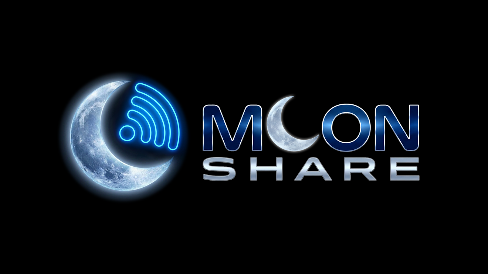

<p align="center">
  
</p>

# MoonShare — Tela e arquivos pelo Wi-Fi

Transmita a tela do celular para outro aparelho ou para o PC e envie arquivos entre seus dispositivos, tudo pela rede local: sem cabo, sem conta e sem nuvem.

## Recursos
- **Espelhamento de tela** entre aparelhos Android, Android TV e Windows, com vídeo em H.264 por hardware e baixa latência.
- **Áudio** do aparelho junto com a tela, quando o Android permite (Android 10 ou mais novo).
- **Envio de arquivos e pastas** entre os aparelhos com o app aberto. Eles se encontram sozinhos na rede.
- **Modo navegador:** veja a tela do celular em qualquer PC, sem instalar nada.
- **Nome do aparelho personalizável** pela engrenagem de configurações, para identificar cada dispositivo na lista.
- **Atualização:** o app avisa quando há versão nova.
- **Privacidade:** os dados ficam na sua rede local e não passam por servidores externos.

## Plataformas
- Android 7.0 ou mais novo (celular, tablet e Android TV)
- Windows (aplicativo MoonShare para Windows)

## Limitações
- O MoonShare não aparece no Win+K: o Android não permite que apps funcionem como receptor Miracast/Cast. No PC, use o modo navegador ou o aplicativo para Windows.
- O áudio depende do aparelho e da versão do Android. Sem suporte, o vídeo segue normalmente sem som.
- Roteadores com isolamento de clientes (como algumas redes de convidados e Wi-Fi público) podem impedir que os aparelhos se encontrem. Nesse caso, conecte pelo IP.
- A resolução é definida ao iniciar a transmissão. Girar a tela do aparelho durante a sessão pode mostrar o conteúdo com faixas.

## Build
```
./gradlew assembleDebug
```
